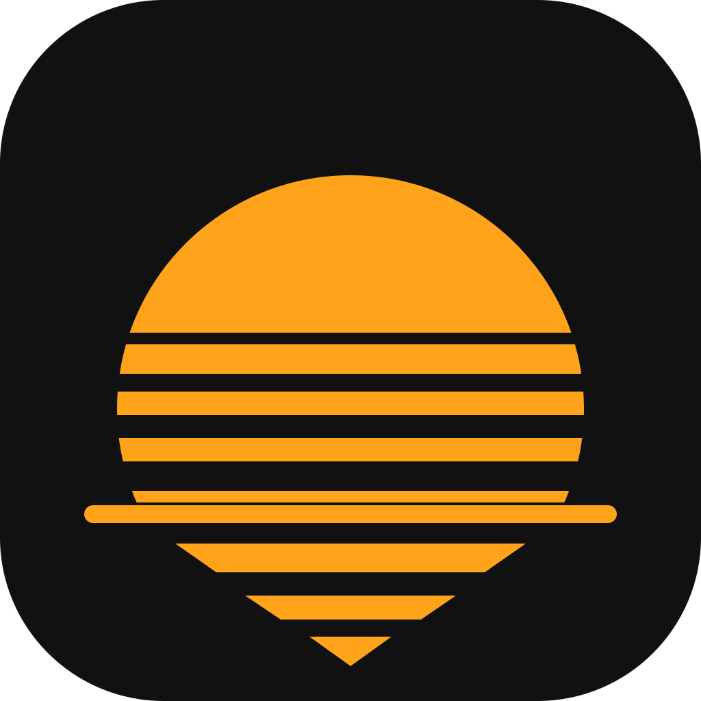
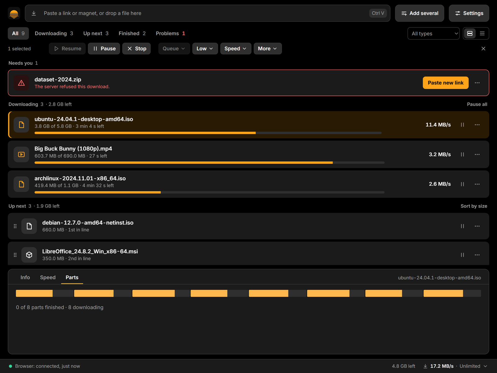
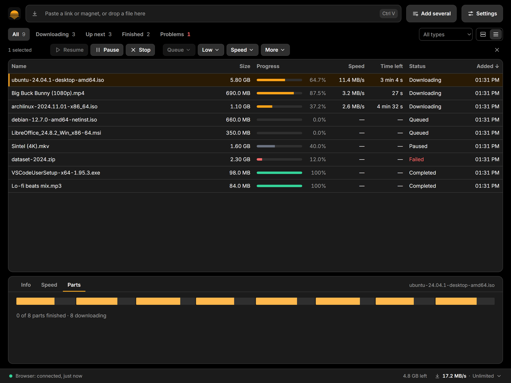
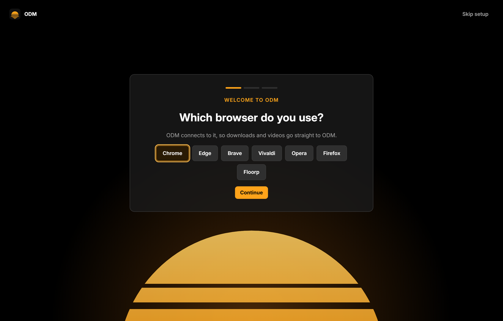

# ODM

**A fast, free download manager for Windows and Linux.** 
Files, videos from 1,000+ sites, streams and torrents, in one clean app. No ads, no accounts, no tracking.

[**Download for Windows**](https://github.com/maysalim-sudo/ODM/releases/latest/download/ODM-setup.exe) &nbsp;·&nbsp;
[**Linux (.deb)**](https://github.com/maysalim-sudo/ODM/releases/latest/download/ODM-amd64.deb) &nbsp;·&nbsp;
[**Linux (.rpm)**](https://github.com/maysalim-sudo/ODM/releases/latest/download/ODM-x86_64.rpm) &nbsp;·&nbsp;
[**AppImage**](https://github.com/maysalim-sudo/ODM/releases/latest/download/ODM-x86_64.AppImage)

## Why ODM

I built ODM because I couldn't find a free download manager I liked: the good ones cost money, and the free ones came with ads, clutter or a dated look. ODM is the one I wanted.

- **Fast.** Splits each file into parts and downloads them at the same time, and keeps going when a server refuses extra connections.
- **Never loses a download.** Resumes after a pause, a crash, a reboot or a dropped connection. An expired link? Paste a fresh one and it carries on from where it stopped.
- **Videos, not just files.** Saves videos from YouTube, Facebook, Instagram, X, TikTok, Vimeo and more (through yt-dlp), plus HLS streams and plain video files. Video or MP3, your choice.
- **One click from YouTube.** Hover any thumbnail and click the ↓. No need to open the video.
- **Takes over your browser's downloads.** Chrome, Edge, Brave, Vivaldi, Opera, Firefox and Floorp, with the page's cookies, so logged-in downloads work.
- **Torrents too.** Magnet links and .torrent files, with a choice of which files to get. ODM downloads; it doesn't keep seeding.
- **In control.** A queue you can reorder, speed limits for everything or one download, schedules, and sleep or shut down when the queue is done.
- **Safe updates.** Every update is signed and checked before it installs.
- **Private.** Collects nothing about you. The only thing it contacts on its own is GitHub, to check for updates.

| Detailed view | First start |
| --- | --- |
|  |  |

## Install

1. **Download and install.**
   - **Windows 10 and 11:** [`ODM-setup.exe`](https://github.com/maysalim-sudo/ODM/releases/latest/download/ODM-setup.exe). It installs for your user only, so it needs no admin rights. The installer isn't code-signed yet, so Windows may show "Windows protected your PC": choose **More info → Run anyway**.
   - **Linux:** [`.deb`](https://github.com/maysalim-sudo/ODM/releases/latest/download/ODM-amd64.deb) for Ubuntu, Debian and Mint, [`.rpm`](https://github.com/maysalim-sudo/ODM/releases/latest/download/ODM-x86_64.rpm) for Fedora and openSUSE, or the [AppImage](https://github.com/maysalim-sudo/ODM/releases/latest/download/ODM-x86_64.AppImage) for almost anything else (make it executable and run it).
2. **Connect your browser.** The welcome screen walks you through it in three short steps and says when the extension is connected.
3. **Optional: get the video tools.** One click in the welcome screen or Settings → Video downloads [FFmpeg](https://ffmpeg.org/), [yt-dlp](https://github.com/yt-dlp/yt-dlp) and [Deno](https://deno.com/) into ODM's own folder, each checked against its published checksum.

From then on ODM keeps itself up to date. Update the app and the browser extension together; ODM tells you when the extension is older.

## Using ODM

- **Add a download:** press **Ctrl+V** anywhere to paste a link, or drop a link, a `.torrent` file or a magnet link on the window. ODM reads the link and asks only for what it needs; the rest is under **More options**. It warns when the link is already in your list, suggests a free name when the file name is taken, and offers your recent folders under **Save to**. Choosing **Later** shows the file's size, warns when the drive is too full, and says when the link expires.
- **The list** groups downloads into Needs you, Downloading, Up next and Finished, and each one has its own buttons. The view switch shows the detailed table instead.
- **Many downloads at once:** select them (Ctrl+A selects all) and use the action bar above the list (Resume, Pause, Stop, and the Queue, Low, Speed and More menus), or right-click. **Low** puts a download last in line and slows it down.
- **What downloads next:** drag rows in Up next, use Move to top, Move up and Move down, or press **Alt+Up** and **Alt+Down**.
- **Details:** click a download to see it in the panel under the list, with tabs for Info, Speed, Parts, and Files and peers for torrents. Double-click a finished download to open it.
- **Videos:** on YouTube, hover a thumbnail and click the ↓ to save it as video or MP3 without opening it. On other pages, use the button over a video, the page's video list or the extension's popup. MP3s go to your Music folder and need FFmpeg from the video tools.
- **Torrents:** choose which files to download before it starts, and change them later in the Files and peers tab. ODM is a downloader, not a seeding client: a torrent stops sharing once its files are complete.

<b>All settings</b>

Open **Settings** from the header, the tray, or with **Ctrl+,**. Changes apply at once. **Restore defaults** resets one section, and the search box finds any option. There are six sections:

- **Essentials:** the settings most people change: the download folder, sorting by type, how many downloads run at once, the speed limit, notifications, keeping ODM in the tray, and update checks. Each also lives in its own section below.
- **Downloads:**
  - The download folder. New installs save to `%USERPROFILE%\Downloads\ODM`; if you already use ODM, your folder stays as it is.
  - Sort into folders by type.
  - When a file already exists: keep both (rename), replace it, or ask.
  - When a download finishes: do nothing, open its folder, open the file, or ask (ODM comes forward and asks).
  - Start new downloads at once or paused. With paused, the New download window also has **Start now**.
  - How many downloads run at once.
  - Remove finished downloads from the list after a number of days. Only the list entry goes; the file stays.
  - A total speed limit, optionally only at certain times (days and hours).
  - Connections per download.
  - **Run the queue at certain times:** queued downloads start at the start time and pause at the stop time. Outside those hours the list shows "Waiting for the schedule (starts 01:00)". To start one anyway, select it and press **Resume**, or choose **Start now** in the New download window. **Resume all** follows the schedule.
  - **When the queue is done:** do nothing, sleep, shut down, or quit ODM. ODM shows a notification and counts down 60 seconds first; press **Cancel** to stop it. A download that starts during the countdown also cancels it.
  - The speed chip in the status bar and the tray's speed menu set a quick limit.
- **Browser:** take over downloads from the browser, ask where to save each one, a minimum file size, file types and sites to leave to the browser, and the browser connection check.
- **Video:** get the video tools (FFmpeg, yt-dlp, Deno), the preferred quality (or audio only, as MP3), the format (MP4 or MKV) and subtitles. **Update video tools** appears only when a newer yt-dlp or Deno is out, or FFmpeg is over four months old.
- **Torrents:** the listen port, router port opening (UPnP), uploading while downloading, and peers per torrent.
- **Advanced:**
  - Start ODM with Windows (it starts in the tray), start minimized, keep running in the tray when the window is closed, notifications for finished and failed downloads, and prevent sleep while downloading.
  - The proxy (the Windows proxy settings, no proxy, or your own address, used for downloads, video tools and updates), timeouts and retries.
  - Updates: check automatically, and when an update is ready: ask me, or install when I quit ODM.
  - A custom User-Agent (browser downloads keep the browser's), the paths to FFmpeg and yt-dlp, ODM's folders, and **Reset all settings**.

<b>Updates</b>

ODM checks its GitHub releases 10 seconds after it starts and then every 6 hours, unless you turn that off in Settings → Updates. When a new version is out, a banner says so. **What's new** shows the changes, **Update** downloads and installs it and restarts ODM, and **Later** hides the banner until the next version. With "Install when I quit ODM", the update downloads in the background and installs when you quit (or press **Install now**).

On Linux, from 0.4.3 on, the AppImage replaces itself and a `.deb` or `.rpm` install asks for your system password. A copy older than 0.4.3 needs the new package installed by hand once.

Every update is signed. ODM checks the signature against the key built into it and refuses an update that does not match. Builds you make yourself without the key never check for updates.

<b>Browser extension details</b>

- Click a download link as usual: ODM takes it with the page's cookies and Referer. If ODM doesn't answer within 5 seconds, the browser keeps the download.
- Hold **Alt** while clicking to let the browser download it instead. Small files, sites on the skip list and file types you choose also stay in the browser.
- Right-click a link, video or audio and choose **Download with ODM**.
- The toolbar popup shows ODM's state, active and queued downloads, the total speed and the videos on the page, and can turn video detection off for a site or everywhere.
- If ODM is closed, a captured download starts it in the tray.
- Until the store listings are approved, the extension is loaded by hand: the welcome screen opens the folder and the right page. Firefox forgets a temporary add-on when it restarts.

<b>Video streams (HLS)</b>

- When a page plays an HLS video, the extension shows it in the page's video list and in the popup. Nothing is sent unless you click.
- You can also paste an `.m3u8` link. For a playlist with several qualities, pick one under **Quality**.
- ODM downloads the segments over several connections, resumes after a pause, decrypts AES-128 streams and joins everything into one file with FFmpeg.
- Not supported yet: live streams, SAMPLE-AES encryption, byte-range playlists and DASH (`.mpd`).

## FAQ

**Windows says "Windows protected your PC". Is it safe?** 
The installer isn't code-signed yet, which costs money every year, so SmartScreen doesn't recognise it. Choose **More info → Run anyway**. The code is all here, and every update ODM installs is signed and verified.

**Is it really free?** 
Yes. No ads, no premium tier, no account. MIT licensed.

**Does it seed torrents?** 
No. ODM is a downloader: a torrent stops sharing once its files are complete.

**Where does ODM keep its data?** 
In `%APPDATA%\ODM\` on Windows: the download list, settings and logs. Set `ODM_DATA_DIR` to use another folder.

**What does it send, and to whom?** 
Nothing about you. It checks GitHub for updates, which you can turn off in Settings. See [store/PRIVACY.md](store/PRIVACY.md).

Only download what you have the right to, and respect each site's terms.

## Contributing

Bug reports and ideas are welcome in [Issues](https://github.com/maysalim-sudo/ODM/issues). To build ODM, run the tests or make a release, see [docs/DEVELOPING.md](docs/DEVELOPING.md).

## License

[MIT](LICENSE)
